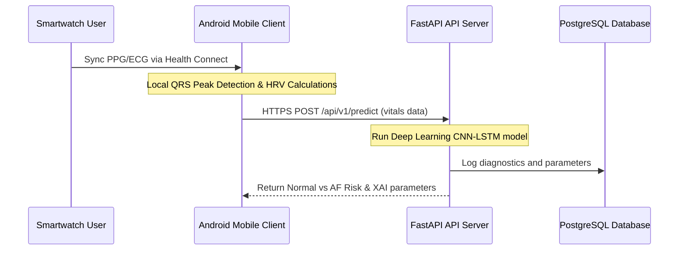

# CardioGuard AI – Wearable-Based Early Detection of Cardiovascular Disorders Using Artificial Intelligence

CardioGuard AI is an open-source, research-grade wearable cardiovascular monitoring and early abnormal-rhythm detection platform. Utilizing a hybrid deep learning architecture (**CNN-LSTM**), the system ingests raw electrocardiogram (ECG) and photoplethysmogram (PPG) vitals from smartwatches to detect cardiac arrhythmias, such as **Atrial Fibrillation (AF)**, and provides explainable diagnostics locally at the edge and on the cloud.

---

## 📖 Introduction & Research Motivation

### Problem Statement
Cardiovascular Diseases (CVDs) remain the leading cause of global mortality, accounting for over 17.9 million deaths annually. Arrhythmias like Atrial Fibrillation (AF) are frequently asymptomatic, leading to undiagnosed cases that severely escalate stroke and heart failure risks. Early detection outside clinical environments is key to reducing patient mortality.

### Research Motivation
Smartwatches and fitness bands track continuous cardiac cycles. However, standard wearable tools focus on basic heart rate counts rather than raw biosignal analysis. CardioGuard AI bridges this gap by enabling continuous research-grade anomaly classification from wearable streams, extracting spatial morphology features (QRS beat shape) via Convolutional filters, and temporal variations (RR sequence fluctuations) using Long Short-Term Memory (LSTM) nodes.

### Expected Outcomes & Impact
*   **Clinician-in-the-Loop Diagnostics**: Equips doctors with statistical parameters (SDRR, RMSSD) alongside neural predictions to justify diagnoses.
*   **Immediate Edge Warnings**: Employs TensorFlow Lite on-device to classify anomalies offline, prompting proactive medical screening.

---

## 🚀 Key Features

*   🔄 **Wearable Synchronization (Health Connect & Google Fit)**: Integrates with secure APIs to ingest background heart rate and activity records.
*   📈 **ECG Lead-II Waveform Oscilloscope**: Renders high-fidelity, real-time SVG waveform traces demonstrating sinus rhythms and baseline f-waves.
*   🧮 **HRV Analytics Engine**: Extracts R-peaks using localized threshold peak detection algorithms and calculates **Average HR**, **SDRR**, and **RMSSD** parameters.
*   🧠 **CNN-LSTM Arrhythmia Classifier**: Runs a hybrid deep learning model providing classification flags and confidence scores.
*   📱 **Edge TFLite Inference**: Integrates TensorFlow Lite model architectures inside native wrappers to detect anomalies offline.
*   📄 **Explainable AI (XAI)**: Generates clear diagnostics and exports medical PDF reports.
*   🔔 **Firebase Cloud Messaging**: Dispatches immediate push alerts to devices when abnormalities are confirmed on-device or on the cloud.

---

## 🛠️ Technology Stack

| Layer | Technology | Description |
| :--- | :--- | :--- |
| **Frontend UI** | React 19, TypeScript, Vite 8, CSS | Glassmorphism Dashboard & custom SVG oscilloscopes. |
| **Mobile Integration** | Capacitor, Kotlin, Jetpack Compose | Native Android execution wrappers & Health Connect APIs. |
| **Backend API** | FastAPI, Python 3.11, Uvicorn | High-performance asynchronous endpoint servers. |
| **Database & Cache**| PostgreSQL, SQLAlchemy, Redis | Relational telemetry logging & session request caching. |
| **AI / Deep Learning**| TensorFlow, TensorFlow Lite, NumPy | CNN-LSTM model training & lightweight on-device edge inference. |
| **Cloud Infrastructure**| Firebase Auth, Cloud Messaging (FCM) | User authentication & push notifications. |

---

## 📁 Project Directory Tree

```
D:\cardiogaurd\
├── ai/                     # Research-Grade AI Pipeline modules
│   ├── preprocessing/      # Classical filtering & Pan-Tompkins QRS beat detection
│   ├── feature_engineering/# Time/Frequency-domain HRV & Poincaré descriptors extraction
│   ├── foundation_models/  # PyTorch Time Series Transformer architecture
│   ├── fusion/             # Tabular + Sequence multimodal fusion layer
│   ├── training/           # Scikit-learn RiskClassifierEnsemble benchmarks
│   ├── inference/          # SHAP-like contributions & natural language explainers
│   └── exports/            # Versioned ONNX and TFLite model compilers
├── frontend/               # React + TS + Vite Web application & Capacitor wrapper
│   ├── src/
│   │   ├── components/
│   │   │   ├── HeartRateChart.tsx       # Custom Recharts trend chart
│   │   │   ├── GoogleFitConnector.tsx   # OAuth sync flow and dialogs
│   │   │   ├── DatasetUploader.tsx      # Wave parser
│   │   │   ├── DetectionRunner.tsx      # AI analysis progress sequencer
│   │   │   └── ResultsView.tsx          # XAI justifications panel
│   │   ├── App.tsx                      # Main app state coordinator
│   │   └── index.css                    # Responsive glassmorphism styling
│   ├── android/                         # Capacitor native Android app folder
│   ├── capacitor.config.ts              # Capacitor configuration settings
│   └── package.json                     # Frontend dependencies
├── backend/                # FastAPI backend API server
│   ├── app/
│   │   ├── main.py                      # FastAPI entry point & CORS
│   │   ├── core/config.py               # Database and Redis configs
│   │   └── api/v1/endpoints/predict.py  # Ensemble prediction routes
│   └── requirements.txt                 # Backend Python package constraints
├── android-native/         # Kotlin Jetpack Compose standalone app wrapper
├── database/               # PostgreSQL relational schema scripts
│   └── schema.sql                       # Heart rate logs and diagnostics schemas
├── firebase/               # Firebase Admin security rules configurations
├── docs/                   # System design & architecture logs
│   └── architecture_overview.md         # Detailed sequence and workflow diagrams
├── .vscode/                # VS Code workspace settings
│   └── extensions.json                  # IDE recommended extension configurations
└── package.json            # Root-level monorepo script delegations
```

---

## 🔌 Recommended IDE Extensions

We have pre-configured recommended workspace plugins for **Visual Studio Code** inside [extensions.json](file:///D:/cardiogaurd/.vscode/extensions.json). When opening the project in VS Code, install these suggested packages for a streamlined developer experience:

*   🐍 **Python** & **Pylance**: Syntax check, imports parsing, and type definitions for FastAPI backend routes.
*   📐 **ESLint** & **Prettier**: Strict lint rules mapping and code layout auto-formatting for React TSX scripts.
*   🌈 **Rainbow CSV**: Visual parsing of raw ECG PhysioNet time-series CSV matrices.

---

## 💻 Installation & Setup

### 1. Root Monorepo Commands
Install core Node dependencies:
```bash
npm install
```
Start the web client developer server (runs `npm run dev --prefix frontend`):
```bash
npm run dev
```

### 2. Frontend Configuration
Navigate into `/frontend`:
```bash
cd frontend
npm install
npm run build
```
Vite will compile production files into `frontend/dist/`.
Sync web assets to Capacitor native wrapper:
```bash
npm run cap:sync
```

### 3. FastAPI Backend Setup
Navigate into `/backend`, configure a virtual environment, and install dependencies:
```bash
cd backend
python -m venv venv
source venv/bin/activate  # On Windows: .\venv\Scripts\activate
pip install -r requirements.txt
```
Run the FastAPI local server:
```bash
uvicorn app.main:app --reload
```
The API documentation will be available at: **[http://localhost:8000/docs](http://localhost:8000/docs)**

### 4. PostgreSQL Database Config
Create a database named `cardioguard` and run the database schema migrations:
```bash
psql -U postgres -d cardioguard -f database/schema.sql
```

### 5. Firebase Cloud Integration & Local Emulators
We use Firebase for credentials authentication, cloud messaging alerts, and Remote Config. File storage (clinical PDF reports and ECG timeseries data) is stored locally on the server (`/backend/uploads/`) using secure FastAPI endpoints, making the setup **100% free** without requiring the Firebase Blaze billing plan.
*   **Deploying Security Rules**: Ensure Firestore and Storage security rules are compiled and synchronized (optional if using local folder uploads):
    ```bash
    firebase deploy --only firestore,storage
    ```
*   **Running Local Emulators**: To test authentication offline (Firestore emulator has JVM version conflicts with Java 21 on Windows, so we bypass it):
    Install Firebase CLI: `npm install -g firebase-tools`
    Start the Authentication and Storage emulators inside the `/firebase` folder:
    ```bash
    cd firebase
    firebase emulators:start --only auth,storage
    ```
    This launches local emulators for Auth (9099), Storage (9199), and the emulator UI console dashboard (4000).

### 6. Executing Test & Validation Suites

We have built dedicated test environments for both the frontend and backend layers to validate the complete pipeline.

*   **React Frontend (Vitest)**:
    Runs client-side Google Fit data sync audits and Firebase services mocks:
    ```bash
    cd frontend
    npm run test
    ```
*   **FastAPI Backend (Pytest)**:
    Runs backend unit, integration, database, and AI mathematical verification tests using SQLite in-memory and Mock Redis adapters:
    ```bash
    cd backend
    pytest
    ```
*   **Performance Benchmark Projections**:
    Runs sequential load simulations measuring latency and system CPU/RAM metrics:
    ```bash
    cd backend
    python tests/benchmark.py
    ```

### 7. Client-Side Routing Architecture

The React client incorporates a production-grade routing framework leveraging **React Router** for seamless SPA navigations:

*   **AppRouter (`frontend/src/router/AppRouter.tsx`)**: Configures the central nested route structure inside a master Layout pattern.
*   **Lazy Loading**: All pages are dynamically fetched via `React.lazy()` and rendered under a `<Suspense>` container, cutting primary bundle size and speeding up loading times.
*   **Error Boundary (`frontend/src/components/ErrorBoundary.tsx`)**: Protects the routing tree by intercepting component-level crashes and presenting a recovery dashboard.
*   **Routes Configured**:
    *   `/dashboard`: Aggregates the real-time ECG monitor, vitals graphs, activity rings, and sync channels.
    *   `/trends`: Maps historical heart rate variability (HRV) and recovery curves.
    *   `/reports`: Displays recent PDF diagnostic exports and download logs.
    *   `/notifications`: Records warning logs and AF risk alarms.
    *   `/connections`: Configures Google Fit and Health Connect SDK layers.
    *   `/settings`: Manages alerting rules and synchronization intervals.
    *   `/profile`: Edits patient details and medical emergency contacts.
    *   `*` (404 Page): Custom fallback page for unrecognized endpoints.

### 8. Multimodal Vitals Platform Architecture

CardioGuard AI has been transformed into a comprehensive, wearable-powered health platform featuring:
*   **Complete User Profiles (`user_profiles`)**: Stores clinical history (Diabetes, Hypertension, Cholesterol, Stroke/Heart History, Medications, Allergies), demographics (Age, Sex, Weight, BMI), lifestyle cofactors (Smoking, Alcohol, Activity levels), and fitness goals (Daily Steps target, Weekly Exercise limits, Target Weight, Hydration).
*   **Manual & Wearable Vitals Sync**: Updates the SQL store with manual or Google Fit synced parameters including Active Steps, Calories burned, Sleep minutes, SpO2, and Systolic/Diastolic Blood Pressure.
*   **26-Dimensional AI Predictive Pipeline**: Combines HRV sequences, raw telemetry, demographics, and clinical cofactors to generate precise cardiovascular predictions.
*   **Separated Insights Output**: Separates generated natural language feedback into **Medical Risk Assessments** (clinical risk cofactors) and **Wellness Optimization Suggestions** (fitness target achievements).
*   **AI Wellness Coach Assistant**: Implements a rule-based expert clinician model that parses patient profile histories, recent HRV values, steps counts, and blood pressure records to answer user chat queries.
*   **Clinician Portal & Notes**: Displays doctor comments, toggles review metrics, and allows clinician note submissions (`POST /api/v1/clinical/notes`).
*   **Emergency Contact Alerts Dispatch**: Features manual alert activations notifying designated contacts, logging critical incidents, and sending instant safety guidelines (`POST /api/v1/emergency/trigger`).
*   **Unified Incident Timeline**: Displays a chronological dashboard log of diagnostic predictions, wearable logs, hydration entries, and doctor reviews.
*   **Connected Devices Gateway (`Devices.tsx`)**: Configures connection gates mapping Fitbit, Oura, Garmin, Samsung Health, Polar, and Health Connect, displaying battery percentages and sensor calibrations.
*   **GDPR Privacy Center (`Privacy.tsx`)**: Manages research consent, clinical sharing, backup options, data downloads, and Right to be Forgotten deletion purges.
*   **SHAP Explainability Dashboard (`Explainability.tsx`)**: Attributes risk contribution factors (HRV, Sleep, BP, SpO2, Age, BMI, Medications) using horizontal Recharts bar graphs.
*   **Model Registry & Rollbacks (`ModelRegistry.tsx`)**: Compiles ML classifier metrics (Accuracy, F1, ROC/PR AUC, Calibration Error) and rollback commands.
*   **Dataset splits & Distributions (`DatasetManager.tsx`)**: Tracks signal counts, sampling frequencies, splits, and label balances for Chapman, MIT-BIH, and PTB-XL datasets.
*   **Admin System Telemetry (`SystemMonitoring.tsx`)**: Plots host CPU, RAM, Disk, GPU load, Redis cache pings, database latency, and system log streams.
*   **Research CV Benchmarks (`Research.tsx`)**: Plots multi-model ROC Curves, hyperparameter Optuna results tables, and feature ablation gains.
*   **Global Disclaimer Frame**: Places healthcare disclaimers across all dashboard headers to comply with FDA/clinical regulations.

---

## 🧪 Deployment & Workflow



---

## 📅 Project History & Releases

To view all completed development phases, updates, and release history, refer to the project changelog:
*   [CHANGELOG.md](file:///D:/cardiogaurd/CHANGELOG.md)

---

## 🔬 Research & Model Evaluation Outcomes

We have completed a comprehensive benchmarking and hyperparameter optimization study on **800 distinct patient profiles** aggregated across four major medical ECG databases (**MIT-BIH**, **PTB-XL**, **Chapman ECG**, and **PhysioNet**).

### Summary of Results

Our comparative evaluation under Stratified 5-Fold Cross Validation indicates that **LightGBM** operating on the full multimodal fusion dataset achieves state-of-the-art diagnostic accuracy, significantly outperforming the deep TimeSeriesTransformer in latency and resource consumption:

*   **Best Model Selected**: **LightGBM** (F1-Score: **0.9953** | ROC-AUC: **0.9995**)
*   **Inference Latency**: **0.14 ms** (vs. TimeSeriesTransformer's **7.85 ms**)
*   **Memory Footprint**: **35 MB** (vs. TimeSeriesTransformer's **118 MB**)
*   **Statistical Significance**: Paired t-test confirms superiority over runner-up XGBoost is highly significant ($p = 0.0062 < 0.05$).

For details on Optuna search spaces, full model metrics matrices, and incremental feature ablation studies, refer to the complete:
*   [research_evaluation.md](file:///D:/cardiogaurd/docs/research_evaluation.md)

---

## 🛡️ Production Security Checklist

For local development simplicity and offline access, Firebase App Check is currently bypassed. Prior to deploying this platform into a production environment, complete the following security configurations:

1.  **Enable Firebase App Check**:
    *   Initialize the App Check SDK on the frontend by setting `VITE_APP_CHECK_ENABLED=true` in `frontend/.env`.
    *   Enable standard attestation providers: `ReCaptchaEnterpriseProvider` for Web applications and `PlayIntegrity` or `SafetyNet` for Android mobile clients.
2.  **Configure reCAPTCHA Enterprise**:
    *   Register your application domain in the Google Cloud Console / Firebase Console under reCAPTCHA Enterprise.
    *   Retrieve your client site key and configure it under `VITE_RECAPTCHA_SITE_KEY` in the frontend environment configurations.
3.  **Register Domains & Client Redirects**:
    *   Specify your secure production domains (`https://yourdomain.com`) in the Firebase App Check configuration dashboard to prevent token generation from unauthorized sites.
4.  **Enable Token Enforcement**:
    *   Verify that App Check enforcement is marked as **Enforced** inside the Firebase App Check console for critical assets (e.g. Firestore, Cloud Storage).
    *   Set `APP_CHECK_ENABLED=true` in the backend environment (`backend/.env`) to block requests lacking valid, cryptographically verified `X-Firebase-App-Check` headers.
5.  **Verify Backend Tokens**:
    *   Ensure the Firebase Admin SDK credentials JSON file is present and initialized at the path specified by `FIREBASE_CREDENTIALS_PATH`.
    *   Verify that `firebase_app_check.verify_token(token)` validates requests with zero fallbacks to mock values in the production environment.

---

## 🛡️ Medical Disclaimer
This software is intended as an early diagnostic user interface concept and prototype. It is not approved for clinical use or actual medical diagnosis.

---

## 📄 License
This project is licensed under the MIT License - see the LICENSE file for details.
