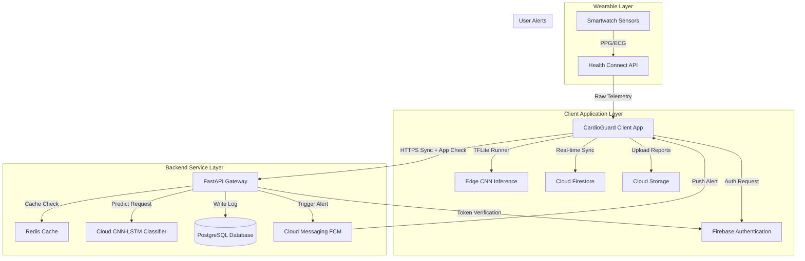
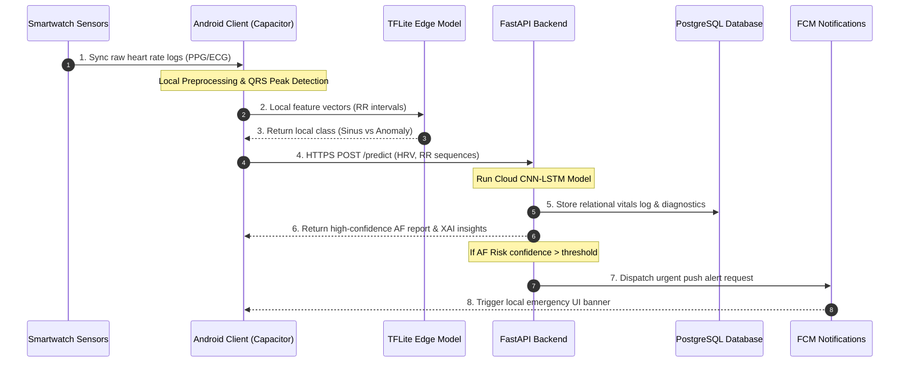
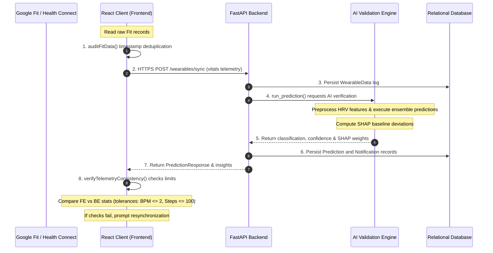

# CardioGuard AI – System Architecture & Data Flow

CardioGuard AI is structured as a multi-tier, high-availability platform that processes raw biosignals at the edge (on-device) and on the cloud using deep learning classifiers.

---

## 1. System Architecture Layout

The platform is divided into five core layers:
1.  **Wearable Hardware Layer**: Smartwatches (Wear OS, Fitbit) tracking PPG pulses and ECG electrodes.
2.  **Edge Execution Layer (Mobile Client)**:
    *   **Health Connect / Google Fit SDK**: Ingests background heart rate logs.
    *   **TensorFlow Lite Inference Engine**: Runs light-weight CNN classifications locally on-device.
3.  **Firebase Cloud Layer**:
    *   **Firebase Authentication**: Handles secure Email/Password and Google credentials login.
    *   **Cloud Firestore**: Syncs user profile states, preferences settings, and prediction history summaries.
    *   **Cloud Storage**: Retains raw telemetry timeseries data and clinical PDF report exports.
    *   **Cloud Messaging**: Dispatches real-time alerts.
4.  **API Gateway & Business Layer (FastAPI backend)**:
    *   Exposes endpoints to sync data, authenticate users, and serve deep learning predictions.
    *   Integrates **App Check** verification filters to protect backend APIs.
    *   Integrates a **Redis cache** to throttle requests and store temporary sessions.
5.  **Data Storage Layer**:
    *   **PostgreSQL**: Securely logs relational telemetry data and AI diagnostic reports.

---

## 2. Complete Data Flow Specifications

The lifecycle of vital signs follows a sequential processing pipeline:

### Detailed Subsystem Data Stages:

1.  **Wearable Ingestion**: Sensors gather raw pulse telemetry. The data is written to the on-device secure data store (**Health Connect**).
2.  **Mobile Preprocessing**: The client reads the data. If raw ECG data is parsed, a threshold-based peak detector extracts **R-peaks** (QRS complexes) and computes **RR beat intervals**.
3.  **Local Edge Inference**: Local feature intervals are evaluated against a compact **TensorFlow Lite CNN model** to provide instant on-device warnings.
4.  **Backend Serialization**: Telemetry is sent to the cloud. The **FastAPI backend** validates the JSON payload using **Pydantic schemas** and queues it in a **Redis** memory pool.
5.  **Deep Learning Analysis (CNN-LSTM)**: The backend processes the sequence:
    *   **1D Convolutional Neural Network (CNN)**: Extracts spatial pulse waveforms.
    *   **Long Short-Term Memory (LSTM)**: Learns time-series sequence intervals.
    *   Produces the classification labels and confidence score.
6.  **Explainable AI (XAI)**: Generates detailed biological parameters (Average HR, SDRR, and RMSSD) to justify the classification to medical professionals.
7.  **Relational Persistence**: Logs details in **PostgreSQL**.
8.  **Cloud Alerts**: If Atrial Fibrillation is flagged, the **Firebase Admin SDK** is triggered to dispatch an urgent push alert to the client.

---

## 3. Data Integrity & Validation Pipeline

To achieve production-grade reliability, CardioGuard AI implements real-time consistency checks and automated validation hooks across both the client and server layers.

### Validation Mechanisms Built:
1.  **Duplicate Filtering**: The client-side sync pipeline executes `auditFitData()` to inspect raw timestamps, discarding duplicates and preventing data inflation before sending payloads.
2.  **Model Consistency**: The AI pipeline verifies that identical sequence grids yield identical predictions across subsequent model invocations (tested in `test_ai_validation.py`).
3.  **Explainability Correspondence**: The SHAP pipeline compares tabular values against baseline physiological constants. If risk is high, contributions are verified to have correct polarities (e.g. low SDNN drives positive risk weightings).
4.  **Database Cascading Rules**: The relational database models enforce `ondelete="CASCADE"` and `delete-orphan` parameters, ensuring orphans are pruned automatically.

